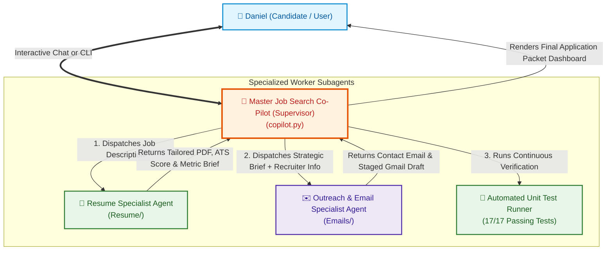

# 🏛️ Multi-Agent System Manifest & Architecture (`AGENTS.md`)

This repository powers **Daniel Suh's Autonomous Job Application Co-Pilot**. It is structured as a **Hierarchical Supervisor Multi-Agent System** that automates high-match resume tailoring and personalized recruiter outreach.

---

## 👥 The 3-Tier Multi-Agent Hierarchy



---

## 🎭 Agent Directory & Role Specifications

### 1. 👑 Master Supervisor Co-Pilot
* **Entry Point:** [`copilot.py`](file:///Users/danielsuh/Documents/Coding%20Stuff/Job%20Applications/copilot.py)
* **Role:** Career Chief of Staff & Orchestrator.
* **Responsibilities:**
  - Manages user interactions (Interactive Guided Mode or headless CLI).
  - Coordinates the sequence: Resume Specialist $\rightarrow$ Outreach Specialist $\rightarrow$ Test Runner.
  - Maintains narrative consistency between the tailored resume and the outreach copy.
  - Enforces the **Fail-Fast Policy** and displays the final summary dashboard.

---

### 2. 📄 Resume & ATS Specialist Worker
* **Location:** [`Resume/`](file:///Users/danielsuh/Documents/Coding%20Stuff/Job%20Applications/Resume)
* **Core Scripts:** [`tailor.py`](file:///Users/danielsuh/Documents/Coding%20Stuff/Job%20Applications/Resume/tailor.py), [`render_pdf.py`](file:///Users/danielsuh/Documents/Coding%20Stuff/Job%20Applications/Resume/render_pdf.py), [`generate_resume.py`](file:///Users/danielsuh/Documents/Coding%20Stuff/Job%20Applications/Resume/generate_resume.py)
* **Knowledge Source:** [`Resume/master_profile.json`](file:///Users/danielsuh/Documents/Coding%20Stuff/Job%20Applications/Resume/master_profile.json) (Daniel's verified achievements, work history, metrics, and skills).
* **Responsibilities:**
  - **Dynamic Bullet Tailoring**: Dynamically selects the top 4 experiences/projects from `master_profile.json` aligned with the JD.
  - **Google X-Y-Z Formatting**: Rewrites bullet points to highlight quantifiable business and technical impact.
  - **Deterministic Mathematical ATS Scoring**: Computes composite score:
    $$\text{Score} = \operatorname{round}(0.45 \times \text{Tech} + 0.30 \times \text{Biz} + 0.25 \times \text{Keywords})$$
  - **1-Page PDF Geometry Validator**: Renders HTML/CSS via Headless Chrome and programmatically validates that the PDF is strictly **1 page**.
  - **Artifact Output**: Saves timestamped output folders with `Daniel_Suh_Resume_<Company>.pdf`, `tailoring_report.md`, `resume.md`, `resume.html`, and `tailored_resume.json`.

---

### 3. 🧠 Seniority & Hierarchy Sanity Specialist Worker
* **Location:** [`Emails/`](file:///Users/danielsuh/Documents/Coding%20Stuff/Job%20Applications/Emails)
* **Core Script:** [`contact_auditor.py`](file:///Users/danielsuh/Documents/Coding%20Stuff/Job%20Applications/Emails/contact_auditor.py)
* **Responsibilities:**
  - **Role Seniority Tier Classification**: Automatically identifies job seniority tier (`INTERNSHIP`, `NEW_GRAD`, `MID_LEVEL`, `EXECUTIVE`).
  - **Decision-Maker Calibration**: Flags executives/partners who are too senior for student outreach; prioritizes Campus Recruiters (Priority 1 Gatekeepers) and Engagement Managers/Haas Alumni (Priority 2 Referrals).
  - **API Credit Preservation**: Screens candidate pools *before* invoking Hunter.io to conserve API lookup credits.
  - **Visual Sanity Audit Reporting**: Generates color-coded ratings (🟢 Optimal Gatekeeper, 🟢 Referral Target, 🟡 High-Level, 🔴 Too Senior).

---

### 4. ✉️ Outreach & Recruiter Specialist Worker
* **Location:** [`Emails/`](file:///Users/danielsuh/Documents/Coding%20Stuff/Job%20Applications/Emails)
* **Core Scripts:** [`agent.py`](file:///Users/danielsuh/Documents/Coding%20Stuff/Job%20Applications/Emails/agent.py), [`gmail_draft.py`](file:///Users/danielsuh/Documents/Coding%20Stuff/Job%20Applications/Emails/gmail_draft.py), [`resume_finder.py`](file:///Users/danielsuh/Documents/Coding%20Stuff/Job%20Applications/Emails/resume_finder.py)
* **Knowledge Sources:**
  - [`Emails/email-agent-context.md`](file:///Users/danielsuh/Documents/Coding%20Stuff/Job%20Applications/Emails/email-agent-context.md) (Persona, voice, tone, signature).
  - [`Emails/memory.md`](file:///Users/danielsuh/Documents/Coding%20Stuff/Job%20Applications/Emails/memory.md) (Learned preferences and active context).
  - [`Emails/skills/`](file:///Users/danielsuh/Documents/Coding%20Stuff/Job%20Applications/Emails/skills) (Antigravity Skills).
* **Responsibilities:**
  - **Recruiter Email Discovery**: Resolves company domains and searches Hunter.io API.
  - **Tailored Resume Bridge**: Auto-discovers and attaches the matching custom PDF from `Resume/output/`.
  - **Multi-Touch Sequence Generation**:
    - **Touch 1 (Next-Business-Day 9:00 AM Outreach)**: Scheduled to send at **9:00 AM on the next business day** (Monday if created Friday/weekend). Dynamic Gemini AI copy under 120 words with concrete metric citation matching the JD and standard subject: `Following up: [Role Title] — Daniel Suh`.
    - **Touch 2 (2-Business-Day Threaded Nudge @ 9:03 AM)**: 100% deterministic short-nudge template sent in the same thread exactly **2 business days** after Touch 1 at **9:03 AM** (skipping weekends):
      *"Following up in case my note below got buried, totally understand things get busy. Would still love the chance to connect if timing works on your end!"*
  - **Gmail API Draft Staging**: Drafts only (never auto-sends) with RFC 2822 `In-Reply-To` and `threadId` chaining.
  - **Reply Detection & Kill-Switch**: Inspects threads for incoming recruiter replies; aborts Touch 2 if a reply is detected.

---

## 🔒 Mandatory Operating Policies

1. **🛑 Strict Fail-Fast & Zero-Hallucination Mandate**:
   - If any critical data, metric, contact, or file is missing or fails validation, **never guess, forge, or fabricate**. Immediately halt execution and alert Daniel with the exact diagnostic issue.
2. **🧪 Mandatory Unit Testing & Coverage**:
   - Whenever any code changes or new features are introduced, corresponding unit tests must be added to [`Emails/test_emailer.py`](file:///Users/danielsuh/Documents/Coding%20Stuff/Job%20Applications/Emails/test_emailer.py), [`Resume/test_resume.py`](file:///Users/danielsuh/Documents/Coding%20Stuff/Job%20Applications/Resume/test_resume.py), or [`test_copilot.py`](file:///Users/danielsuh/Documents/Coding%20Stuff/Job%20Applications/test_copilot.py) and executed to maintain a **100% pass rate**.
3. **🔒 Draft-Only Safety Constraint**:
   - Outbound emails are strictly created as Gmail drafts. Daniel maintains human-in-the-loop control to review drafts before sending.
4. **🖋️ Standardized Signature Block**:
   ```text
   Thanks for your time,
   Daniel Suh
   linkedin.com/in/daniel-suh-994411297 | 661-476-8194
   ```
5. **📬 Mandatory Pre-Flight Gmail Health Check**:
   - Every pipeline invocation runs `verify_gmail_access()` at startup to validate token freshness, Google API connectivity, and compose permissions before executing resume tailoring or draft dispatching.

---

## 🚀 Quick Command Reference

```bash
cd "/Users/danielsuh/Documents/Coding Stuff/Job Applications"

# 1. Interactive Co-Pilot Mode (Recommended)
Emails/.python/python/bin/python3 copilot.py

# 2. Fast Direct CLI Run
Emails/.python/python/bin/python3 copilot.py --file Resume/sample_jd.txt --recruiter "Sarah Jenkins"

# 3. Inspect Gmail Thread for Replies
Emails/.python/python/bin/python3 copilot.py --check-thread "<GMAIL_THREAD_ID>" --email "recruiter@company.com"

# 4. Run Automated Unit Test Suites
Emails/.python/python/bin/python3 copilot.py --test-only
```