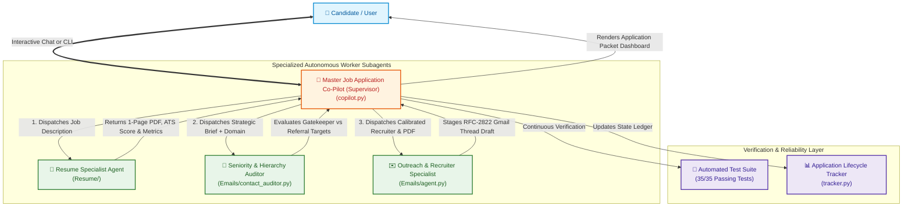

# 🚀 Resume Optimizer & Autonomous Email Outreach Agent

[](#-automated-testing--verification)
[](https://www.python.org/downloads/)
[](#-system-architecture)
[](#-safety--fail-fast-policies)

An end-to-end **autonomous multi-agent system** that takes a job description and coordinates ATS-optimized resume tailoring, hiring manager and recruiter discovery, seniority calibration, and personalized Gmail outreach sequences with safety guarantees.

---

## 🏗️ System Architecture

The system is structured as a **3-Tier Hierarchical Multi-Agent System**:



---

## 🌟 Key Capabilities

### 1. 📄 Dynamic Resume Tailoring & ATS Scoring Engine (`Resume/`)
* **Dynamic Experience Selection**: Selects and ranks the top achievements and roles from `master_profile.json` aligned directly with the target JD.
* **Google X-Y-Z Formatting**: Rewrites bullet points to emphasize quantifiable business impact and technical skills (*"Accomplished [X], as measured by [Y], by doing [Z]"*).
* **Deterministic ATS Scoring**: Computes a mathematical composite ATS match score:
  $$\text{Score} = \operatorname{round}(0.45 \times \text{Tech} + 0.30 \times \text{Biz} + 0.25 \times \text{Keywords})$$
* **1-Page Geometry Enforcement**: Renders HTML/CSS templates via Headless Chrome and strictly validates that the generated PDF does not spill onto a second page.

### 2. 🧠 Seniority & Hierarchy Sanity Auditor (`Emails/contact_auditor.py`)
* **Role Seniority Classification**: Categorizes target roles into `INTERNSHIP`, `NEW_GRAD`, `MID_LEVEL`, or `EXECUTIVE`.
* **Decision-Maker Calibration**: Flags executives, partners, and C-suite leaders who are too senior for initial campus outreach.
* **Candidate Pool Prioritization**:
  - 🟢 **Priority 1 Gatekeepers**: Campus / University Recruiters, Talent Acquisition Leads.
  - 🟢 **Priority 2 Referrals**: Haas / University Alumni, Engagement Managers, Team Leads.
  - 🔴 **Over-Senior Disqualifications**: VPs, Partners, C-level Executives.
* **API Credit Preservation**: Pre-filters contact candidates before making API calls to save Hunter.io lookup credits.

### 3. ✉️ Multi-Touch Recruiter Outreach Engine (`Emails/`)
* **Email Discovery & Domain Resolution**: Resolves company domains via Gemini and verifies patterns with Hunter.io API.
* **Tailored Resume Bridge**: Automatically discovers and attaches the tailored PDF from `Resume/output/` matching the target company.
* **Multi-Touch Sequence Protocol**:
  - **Touch 1 (Next-Business-Day 9:00 AM)**: Tailored intro (under 120 words) referencing the submitted application, a specific high-impact metric from the resume, and attaching the custom PDF.
  - **Touch 2 (2-Business-Day Threaded Nudge @ 9:03 AM)**: Ultra-concise threaded follow-up in the same email conversation:
    > *"Following up in case my note below got buried, totally understand things get busy. Would still love the chance to connect if timing works on your end!"*
* **Reply Detection & Kill Switch**: Inspects Gmail threads before sending Touch 2; cancels follow-up automatically if a reply has been received.

### 4. 📊 Application Lifecycle & Ledger Tracking (`tracker.py`)
* Tracks application stages: `Draft Staged` $\rightarrow$ `Touch 1 Sent` $\rightarrow$ `Touch 2 Queued` $\rightarrow$ `Interviewing` $\rightarrow$ `Offer`.
* Computes real-time conversion rates and average ATS scores.

---

## 🔒 Safety & Fail-Fast Policies

1. **Draft-Only Execution**: Outbound emails are **strictly created as Gmail drafts** (`gmail.compose`). Human-in-the-loop review is mandatory before any email is sent.
2. **Zero-Hallucination & Fail-Fast Mandate**: If any critical contact, file, metric, or API response fails validation, the system **never invents data**. It halts immediately and alerts the user with an exact diagnostic message.
3. **Pre-Flight Gmail Health Check**: Every pipeline run verifies OAuth token validity and Gmail API connectivity before triggering tailoring or email composition.
4. **Automated Unit Testing**: All 35 unit test cases across `copilot.py`, `Emails/`, and `Resume/` must pass at 100% on every update.

---

## 📁 Repository Structure

```text
.
├── copilot.py                     # Master Supervisor orchestrator & CLI
├── tracker.py                     # Application lifecycle state ledger
├── test_copilot.py                # Automated tests for the supervisor & tracker
├── AGENTS.md                      # Multi-agent manifest & architecture specifications
├── README.md                      # Project documentation & usage guide
├── scripts/
│   └── setup_daily_nudge_daemon.sh # macOS launchd / cron daily follow-up daemon
├── Resume/
│   ├── tailor.py                  # Gemini AI bullet selection & ATS score calculator
│   ├── render_pdf.py              # Headless Chrome HTML-to-PDF renderer & geometry validator
│   ├── generate_resume.py         # Standalone resume pipeline entry point
│   ├── master_profile.template.json # Template for candidate work history & skills
│   ├── master_profile_schema.md   # Schema documentation for master_profile.json
│   ├── test_resume.py             # Unit tests for ATS scoring, math, and rendering
│   └── templates/
│       ├── resume_template.html   # Clean 1-page modern HTML/CSS resume layout
│       └── resume_template.md     # Markdown resume layout
└── Emails/
    ├── agent.py                   # Multi-touch outreach agent & draft dispatcher
    ├── contact_auditor.py         # Seniority tier & hierarchy gatekeeper auditor
    ├── find_email.py              # Hunter.io email pattern discovery & verification
    ├── gmail_draft.py             # Gmail API draft staging & MIME multipart builder
    ├── resume_finder.py           # Auto-attaches corresponding tailored PDF
    ├── run_followup.py            # Sequence scheduler & reply inspection
    ├── test_emailer.py            # Unit tests for recruiter discovery & draft staging
    └── skills/                    # Antigravity agent skill definitions
```

---

## 🚀 Getting Started

### 1. Prerequisites
* **Python 3.10+** (Python 3.11+ recommended)
* **Google Chrome** (used headlessly for 1-page PDF rendering)
* **Google Gemini API Key**
* **Hunter.io API Key** (for recruiter email discovery)
* **Gmail API Credentials** (`credentials.json` for OAuth2 authentication)

### 2. Installation

Clone the repository:
```bash
git clone https://github.com/dsuh-workspace/resume-optimizer-email-outreach-agent.git
cd resume-optimizer-email-outreach-agent
```

Install dependencies:
```bash
pip install -r Emails/requirements.txt
```

### 3. Environment Configuration

Copy the environment template and set your API keys:
```bash
cp Emails/.env.template Emails/.env
```

Edit `Emails/.env`:
```env
GEMINI_API_KEY=your_gemini_api_key_here
HUNTER_API_KEY=your_hunter_api_key_here
```

Place your Google Cloud OAuth client credentials in `Emails/credentials.json`. On first run, a browser window will open to authorize Gmail draft creation permissions (`https://www.googleapis.com/auth/gmail.compose`), saving your token locally.

### 4. Configure Your Career Profile

Copy the master profile template:
```bash
cp Resume/master_profile.template.json Resume/master_profile.json
```
Edit `Resume/master_profile.json` with your real work history, quantifiable metrics, skills, and coursework. See [`Resume/master_profile_schema.md`](Resume/master_profile_schema.md) for field guidelines.

---

## 💻 Usage

### 1. Interactive Co-Pilot Mode (Recommended)
Guides you step-by-step through pasting a JD, tailoring your resume, finding recruiters, auditing seniority, and staging your draft:
```bash
python copilot.py
```

### 2. Direct CLI Run
Provide a job description file and target recruiter directly:
```bash
python copilot.py --file Resume/sample_jd.txt --recruiter "Sarah Jenkins"
```

### 3. Check Staged Gmail Threads for Replies
Inspects active outreach threads and automatically aborts Touch 2 if a response was received:
```bash
python copilot.py --check-thread "<GMAIL_THREAD_ID>" --email "recruiter@company.com"
```

### 4. Background Daily Follow-Up Daemon (macOS)
Installs a `launchd` daily agent to automatically check for due Touch 2 follow-ups every business day at 9:03 AM:
```bash
./scripts/setup_daily_nudge_daemon.sh
```

---

## 🧪 Automated Testing & Verification

Run the comprehensive test suite across all subagents:
```bash
python copilot.py --test-only
```
All **35 automated test cases** cover:
* Deterministic mathematical ATS score calculations ($45/30/25$ weighting)
* JSON sanitization and fallback parsing
* HTML/Markdown template compilation
* Recruiter seniority tier classification and gatekeeper filtering
* Gmail MIME multipart drafting with PDF resume attachment
* 2-Business-Day nudge date arithmetic (skipping weekends)
* Thread reply detection and cancellation safety switch

---

## 📄 License

MIT License. See [LICENSE](LICENSE) for details.
